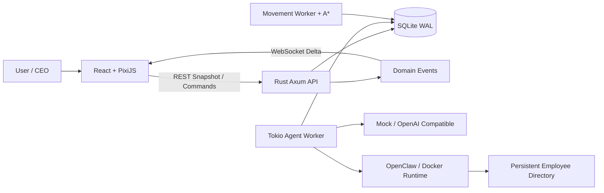

**English** | [简体中文](README.zh-CN.md)

# Agent Company

A persistent, observable, and extensible virtual AI company.

Agent Company turns a multi-agent work system into a continuously running virtual office. AI employees receive messages, process tasks, call models, attend meetings, recruit new colleagues, and physically navigate between desks, meeting rooms, the pantry, and the restroom. The browser is only a visualization client: Rust workers continue processing jobs, movements, and messages after the page is closed, while SQLite preserves the state of the company.

> Agent Company is under active development. It is currently intended for local research, demos, and experimentation—not unattended production use.

## Why Agent Company?

Most agent products are presented as chat windows, task lists, or log viewers. Those interfaces make it difficult to understand what several agents are doing, why one is stuck, who is consuming tokens, and how agents coordinate with each other.

Agent Company is designed as a visual multi-agent operating system and debugger:

- Companies, floors, employees, tasks, meetings, and permissions are persistent domain entities.
- An Agent Runtime is an employee's brain and tool layer. It can be backed by Mock, OpenAI Compatible, OpenClaw, or another runtime.
- The Rust backend owns the authoritative world state. React and PixiJS restore snapshots and visualize domain events.
- Walking, pathfinding, sitting, and returning to a desk are deterministic simulation behaviors and do not consume LLM tokens.
- Each employee can own a persistent host directory, so task containers may be disposable while files and personal toolchains survive.

## Features

### Persistent Agent Runtime

- Background workers built with Rust, Axum, and Tokio continue consuming jobs without a connected browser.
- SQLite WAL persists employees, messages, goals, tasks, jobs, memories, meetings, movements, and domain events.
- Interrupted running jobs are recovered after a backend restart.
- `GET /api/company/snapshot` restores the initial UI state; WebSocket delivers only subsequent deltas.
- Job states include `PENDING`, `RUNNING`, `WAITING`, `COMPLETED`, `FAILED`, and `CANCELLED`.

### Models and Token Usage

- Multiple model providers and the OpenAI Compatible protocol.
- Employees bind to models through `model_profile_id`; provider URLs and API keys are not stored in employee records.
- Provider API keys are encrypted with AES-256-GCM and are never returned in full by query APIs.
- Built-in provider connection testing.
- Per-company and per-employee input, output, cache, and total token accounting, displayed using K/M/T/P units.
- A built-in Mock Provider keeps the main workflow runnable without API keys.

### Virtual Office and Spatial Simulation

- A PixiJS 2.5D office with an open workspace, administrator office, meeting room, interview room, reception, pantry, and restroom.
- Shared Office Layout, Location IDs, Navigation Grid, and obstacle definitions.
- Backend A* pathfinding prevents employees from teleporting or walking through walls and furniture.
- Paths, start times, and estimated arrival times are persisted. Reopening the page restores an employee at the correct point along an active path.
- Agent state is split into independent activity, movement, location, device, posture, and presence dimensions.
- Meeting participants walk to reserved seats independently. A meeting starts only after everyone arrives, and participants physically leave when it ends.

### Employees, Floors, and Administrators

- Employee identity, personality, skills, appearance seed, workstation, model binding, and runtime state are persisted in SQLite.
- Every newly created floor receives a real administrator employee, an administrator office, and a dedicated workstation.
- Administrators handle hiring, offboarding, floor management, and runtime patrols.
- An administrator can inspect employee token usage and active jobs on their floor, and identify jobs with excessive retries or long periods without updates.
- With an explicit intervention command, an administrator can cancel suspected dead-loop jobs before they consume more tokens.
- Offboarding preserves historical chats, tasks, meetings, and work records.

### Hiring

- Describe a hiring requirement to a floor administrator to create a persistent hiring request and position.
- Each position receives three synthetic candidates, with support for generating another batch.
- Candidate identity, age, role, personality, skills, and appearance are persisted. A real provider can generate profiles through the administrator model; Mock mode uses a local generator.
- Age, gender, and appearance are excluded from hiring scores.
- A candidate becomes an employee only after the user explicitly selects and hires them.

### Per-Employee Runtime Environment

- Optional Docker execution based on `debian:stable-slim`.
- Each employee uses their exact `employee_id` as the host directory name.
- Workspace, state, artifacts, HOME, and personal toolchains live on the host; no persistent container ID is required.
- Python, Node.js, Rust, JDK, Gradle, and Maven are intentionally not preinstalled in the base image.
- Employees can maintain tools under persistent locations such as `$HOME/.local`, `$HOME/.cargo`, `$HOME/.rustup`, `$HOME/.gradle`, and `$HOME/.m2`.
- The runtime records personal toolchains and missing system-package suggestions for future base-image upgrades.

## Architecture



The spatial execution pipeline is:

```text
Business Intent
→ Check Activity Location Requirement
→ Move Command
→ A* Pathfinding
→ Persistent Movement
→ Domain Event
→ PixiJS Animation
→ Backend Arrived
→ Start the Real Business Activity
```

The backend does not stream coordinates at 60 FPS. It broadcasts a path, server timestamps, and an estimated arrival time; PixiJS performs smooth local interpolation.

## Technology Stack

| Area | Technology |
| --- | --- |
| Web | React 19, TypeScript, Vite, PixiJS 8, Zustand, native WebSocket |
| Server | Rust, Axum, Tokio, Serde, SQLx |
| Database | SQLite WAL |
| Pathfinding | Rust A* with a navigation grid |
| Models | Mock, OpenAI Compatible, optional OpenClaw |
| Runtime | Optional Docker, Debian stable-slim, persistent employee HOME |

The project intentionally stays lightweight and currently has no dependency on Redis, Kafka, RabbitMQ, Kubernetes, or a physics engine.

## Repository Layout

```text
.
├── apps/
│   ├── web/                  # React + PixiJS frontend
│   ├── server/               # Rust backend, workers, and SQLite migrations
│   └── employee-runtime/     # Lightweight employee container entry point
├── docs/                     # Product specifications and design documents
├── Dockerfile.employee      # Optional employee execution image
├── .env.example             # Local configuration template
└── README.md
```

## Quick Start

### Requirements

- Node.js 20+
- npm
- Rust stable and Cargo
- Optional: Docker
- Optional: OpenClaw Gateway

### 1. Clone and install dependencies

```bash
git clone https://github.com/<your-name>/agent-company.git
cd agent-company
npm install
```

### 2. Configure the environment

```bash
cp .env.example .env
```

Replace the local encryption key before saving any model credentials:

```dotenv
MODEL_PROFILE_ENCRYPTION_KEY=replace-with-a-long-random-local-secret
```

Never commit `.env`, real API keys, gateway tokens, or SQLite database files.

### 3. Start the Rust backend

```bash
cd apps/server
cargo run
```

The server listens on `0.0.0.0:3001` by default. The SQLite database defaults to `apps/server/data/ai_company.db`, and migrations run automatically on startup.

### 4. Start the web app

Open another terminal:

```bash
cd apps/web
npm run dev -- --host 0.0.0.0
```

Open <http://localhost:5173>.

When running the services inside WSL and opening the browser from Windows, both Vite and Rust should listen on `0.0.0.0`. Vite proxies `/api` and `/ws` to the backend.

## Configure a Real Model

1. Open **Models** from the system menu.
2. Add an OpenAI Compatible provider.
3. Enter its name, base URL, API key, and model.
4. Test the connection.
5. Bind an employee to the model profile.
6. Click the employee in the office and send a message from the phone UI.

The message pipeline is:

```text
Browser Persists Message
→ SQLite Creates Agent Job
→ Rust Worker Loads Employee Model Binding
→ Backend Calls Provider
→ Reply and Token Usage Are Persisted
→ WebSocket Broadcasts the Result
```

The browser never calls the LLM directly and never receives the complete provider API key.

## Optional: Employee Docker Runtime

Build the base image:

```bash
docker build \
  -f Dockerfile.employee \
  -t ai-company/employee-base:debian-stable \
  .
```

Enable it in `.env`:

```dotenv
AI_COMPANY_DOCKER_ENABLED=true
AI_COMPANY_EMPLOYEE_IMAGE=ai-company/employee-base:debian-stable
AI_COMPANY_EMPLOYEE_ROOT=data/employee-runtimes
AI_COMPANY_EMPLOYEE_CPUS=2
AI_COMPANY_EMPLOYEE_MEMORY=2g
AI_COMPANY_EMPLOYEE_PIDS=512
```

Then create an employee directory or bind the relevant runtime from the Models page. A directory looks like this:

```text
data/employee-runtimes/company-01/<employee-id>/
├── workspace/
├── state/
├── artifacts/
└── environment/             # Mounted as the employee's HOME
```

The container can execute commands and modify mounted files. Treat it as a boundary for untrusted code: keep mounts minimal, apply CPU/memory/process limits, never mount sensitive host directories, and never expose the Docker socket to an employee container.

## Optional: OpenClaw

OpenClaw is not required when using the Mock or OpenAI Compatible providers.

To run an employee through OpenClaw, install and initialize OpenClaw in the backend environment, start its Gateway, and configure:

```dotenv
OPENCLAW_ENABLED=true
OPENCLAW_GATEWAY_URL=ws://127.0.0.1:18789
OPENCLAW_GATEWAY_TOKEN=your-local-token
OPENCLAW_PROTOCOL_VERSION=4
```

An unavailable OpenClaw instance does not prevent Mock mode from starting. Jobs assigned to an unavailable OpenClaw runtime retain failure records for recovery and debugging.

## Suggested Demo Flows

### Persistent Chat

1. Click an employee to open their phone.
2. Send a message from the **Messages** page.
3. Watch the employee check their phone, think, and receive a reply.
4. Refresh the browser and verify that the conversation, job, tokens, and state are restored.
5. Send another message, close the browser, and reopen it later to verify that the backend completed the work in the background.

### Hiring

1. Create a floor and verify that an administrator and workstation appear automatically.
2. Tell the administrator: `Hire a technology editor who is strong at research and writing.`
3. Review the identity, personality, skills, and appearance of the three candidates.
4. Generate another batch if needed.
5. Select and confirm one candidate. Only then are they persisted as an employee with an employee ID and workstation. When Docker Runtime is enabled, a matching personal directory can be created afterward.

### Meetings and Movement Recovery

1. Click **Start Floor Meeting**.
2. Watch employees stand up at different desks, follow valid paths through the door, and sit in reserved seats.
3. The meeting enters `IN_PROGRESS` only after the last participant arrives.
4. Close the page during movement and reopen it later.
5. Employees who arrived should remain at the destination; active walkers should resume visually from the path position derived from server time.
6. End the meeting and watch participants walk back to their workstations.

### Administrator Patrol

Send the floor administrator a message such as:

```text
Inspect this floor's active jobs and token usage.
```

The current deterministic command parser recognizes the corresponding Chinese patrol commands used by the UI and runtime. It summarizes employee token usage and flags jobs with excessive retries or stale updates. To intervene, send the explicit Chinese command:

```text
解除死循环并停止卡住任务。
```

## Development and Verification

Web:

```bash
npm run typecheck
npm run build
npm run test
```

Rust server:

```bash
cd apps/server
cargo fmt --check
cargo clippy --all-targets --all-features -- -D warnings
cargo test
```

Employee Runtime:

```bash
cd apps/employee-runtime
cargo fmt --check
cargo clippy --all-targets --all-features -- -D warnings
cargo test
```

## Project Status and Roadmap

Implemented foundations:

- Persistent messages, jobs, state, events, and token usage
- Model Provider management
- Office pathfinding and reconnect recovery
- Multi-participant meeting movement and meeting-table messages
- Multiple floors, administrators, hiring, and offboarding
- Optional OpenClaw integration and employee Docker runtime infrastructure

In progress or planned:

- Complete Goal → Task orchestration and autonomous multi-agent collaboration
- More capable administrator diagnosis and task replanning for stuck agents
- A complete interview workflow and richer candidate evaluation
- Production integration with ADK Rust and other Agent Harnesses
- Fine-grained permission policies for files, Shell, Git, browsers, and MCP
- PostgreSQL migration support
- Stronger testing, sandboxing, authentication, and observability

## Design Documents

- [Product and technical specification](docs/AI_COMPANY_PRODUCT_SPEC.md) (Chinese)
- [ADK Rust and employee container design](docs/adk.md) (Chinese)
- [OpenClaw integration specification](docs/AI_COMPANY_OPENCLAW_INTEGRATION_SPEC.md) (Chinese)
- [Natural-language floor and hiring design](docs/楼层自然.md) (Chinese)
- [Employee offboarding design](docs/解雇.md) (Chinese)

## Security

- Never commit real API keys, OpenClaw tokens, `.env`, or SQLite databases.
- Deployment owners must provide `MODEL_PROFILE_ENCRYPTION_KEY` and store it separately from the database.
- Docker Runtime can execute commands and modify mounted directories. Use a non-root user, resource limits, and minimal mounts.
- The current container isolation has not been audited as a hostile-code sandbox.
- Before exposing the service publicly, add authentication, authorization, CSRF/origin checks, rate limiting, and an audit policy.

## License

No open-source license has been selected yet. Add a `LICENSE` file before public release. Apache-2.0 and MIT are common choices if you want to allow community use, modification, and redistribution.
