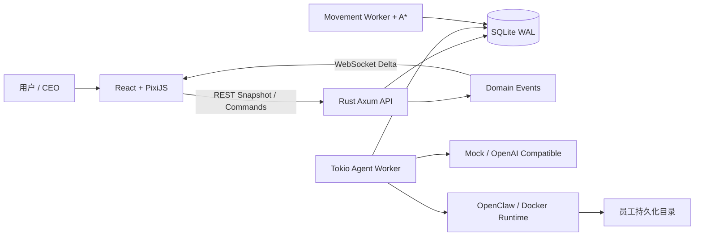

[English](README.md) | **简体中文**

# Agent Company

一个持续运行、可观察、可扩展的虚拟 AI 公司。

Agent Company 把多 Agent 工作系统表现为一间真实运转的办公室：员工会接收消息、处理任务、调用模型、参加会议、招聘新人，也会沿可通行路线走到会议室、工位、茶水间或卫生间。浏览器只是观察这个世界的客户端；即使网页关闭，Rust 后端仍会继续处理 Job、移动和消息，并把所有状态持久化到 SQLite。

> 当前项目处于早期开发阶段，适合本地研究、功能验证和二次开发，暂不建议直接用于无人值守的生产环境。

## 为什么做这个项目

传统 Agent 产品通常是聊天窗口、任务列表或日志面板，很难直观看出多个 Agent 正在做什么、为什么停住、谁在消耗 Token，以及他们之间如何协作。

Agent Company 希望成为一个“可视化的多 Agent 操作系统和调试器”：

- 公司、楼层、员工、任务、会议和权限是长期存在的业务实体。
- Agent Runtime 是员工的大脑和工具，可以替换为 Mock、OpenAI Compatible、OpenClaw 或其他实现。
- Rust 后端掌握真实状态，React + PixiJS 只负责 Snapshot 恢复和事件可视化。
- 走路、寻路、坐下、回工位等行为由确定性模拟引擎处理，不浪费 LLM Token。
- 每位员工拥有独立持久化目录，任务容器可以销毁，文件和个人工具链仍会保留。

## 当前能力

### 持久化 Agent Runtime

- Rust + Axum + Tokio 后台 Worker，无浏览器连接时仍持续消费 Job。
- SQLite WAL 持久化员工、消息、Goal、Task、Job、记忆、会议、移动和领域事件。
- 未完成的运行中 Job 会在后端重启后恢复处理。
- `GET /api/company/snapshot` 负责页面首次恢复，WebSocket 只接收后续增量事件。
- Job 支持 `PENDING`、`RUNNING`、`WAITING`、`COMPLETED`、`FAILED`、`CANCELLED`。

### 模型与 Token

- 支持多个 Model Provider 和 OpenAI Compatible 协议。
- 员工通过 `model_profile_id` 绑定模型，不在员工数据中保存 Base URL 或 API Key。
- Provider API Key 使用 AES-256-GCM 加密保存，查询接口永远不返回完整 Key。
- 支持 Provider 连接测试。
- 按公司和员工统计 input、output、cache、total Token，并使用 K/M/T/P 单位展示。
- 无 API Key 时可使用内置 Mock Provider 跑通主要流程。

### 虚拟办公室与空间模拟

- PixiJS 2.5D 办公室，包含开放工位、管理员办公室、会议室、面试室、前台、茶水间和卫生间。
- 统一 Office Layout、Location ID、Navigation Grid 和障碍物定义。
- Rust 后端使用 A* 寻路，人物不会因为业务状态变化瞬移或穿墙穿桌。
- 移动路径、开始时间和预计到达时间会持久化；重新打开页面可从路径中间继续显示。
- Agent 状态拆分为 activity、movement、location、device、posture、presence 等独立维度。
- 会议参加者分别走到独立座位，全员到齐后会议才开始；散会后再沿路线离开。

### 员工、楼层与管理员

- 员工身份、性格、技能、外观种子、工位、模型和运行状态均持久化在数据库中。
- 每家公司只保留一名权威管理员，统一负责所有楼层的招聘、解雇与运行巡查。
- 管理员同时承担招聘、解雇、楼层管理和运行巡查职责。
- 管理员可以查看本楼层员工的 Token 与活跃 Job，并识别重试过多或长期停滞的任务。
- 收到明确干预指令后，管理员可以取消疑似死循环 Job，阻止其继续消耗 Token。
- 解雇采用持久化 Offboarding 流程，保留聊天、任务、会议和工作记录。

### 招聘

- 向楼层管理员描述招聘需求后，系统创建持久化招聘请求和职位。
- 每个职位生成三名虚构候选人，并可“换一批”。
- 候选人的姓名、年龄、职位、性格、技能和外观均会保存；真实 Provider 可由管理员模型生成，Mock 模式使用本地生成器。
- 年龄、性别和外观不会参与招聘评分。
- 只有用户明确选中并确认录用后，候选人才会成为正式员工并获得工位。

### 员工个人运行环境

- 可选 Docker 执行环境基于 `debian:stable-slim`。
- 每位员工使用自己的 `employee_id` 作为宿主机目录名。
- Workspace、状态、产物、HOME 和个人工具链保存在宿主机，容器不需要长期保存 container ID。
- 基础镜像不预装 Python、Node.js、Rust、JDK、Gradle 或 Maven。
- 员工可以把个人工具安装到 `$HOME/.local`、`$HOME/.cargo`、`$HOME/.rustup`、`$HOME/.gradle`、`$HOME/.m2` 等持久化目录。
- Runtime 会记录个人工具链和缺失系统软件建议，方便未来统一升级基础镜像。

## 架构



核心原则是：

```text
业务意图
→ 检查 Activity 的地点要求
→ Move Command
→ A* Pathfinding
→ Persistent Movement
→ Domain Event
→ PixiJS Animation
→ Backend Arrived
→ 开始真实业务 Activity
```

后端不会以 60 FPS 推送坐标。它只广播路径、服务器时间和预计到达时间，前端使用 PixiJS 在本地进行平滑插值。

## 技术栈

| 模块 | 技术 |
| --- | --- |
| Web | React 19、TypeScript、Vite、PixiJS 8、Zustand、原生 WebSocket |
| Server | Rust、Axum、Tokio、Serde、SQLx |
| Database | SQLite WAL |
| Pathfinding | Rust A* + Navigation Grid |
| Model | Mock、OpenAI Compatible，可选 OpenClaw |
| Runtime | 可选 Docker、Debian stable-slim、员工持久化 HOME |

项目刻意保持轻量，当前不依赖 Redis、Kafka、RabbitMQ、Kubernetes 或物理引擎。

## 目录结构

```text
.
├── apps/
│   ├── web/                  # React + PixiJS 前端
│   ├── server/               # Rust 后端、Worker 和 SQLite migrations
│   └── employee-runtime/     # 员工容器内的轻量运行入口
├── docs/                     # 产品规格和后续设计文档
├── Dockerfile.employee      # 可选员工执行镜像
├── .env.example             # 本地配置模板
└── README.md
```

## 快速开始

### 环境要求

- Node.js 20+
- npm
- Rust stable 和 Cargo
- 可选：Docker
- 可选：OpenClaw Gateway

### 1. 获取代码并安装前端依赖

```bash
git clone https://github.com/<your-name>/agent-company.git
cd agent-company
npm install
```

### 2. 配置环境变量

```bash
cp .env.example .env
```

至少需要替换本地加密密钥：

```dotenv
MODEL_PROFILE_ENCRYPTION_KEY=请替换为足够长的本地随机字符串
```

不要提交 `.env`、真实 API Key、Gateway Token 或数据库文件。

### 3. 启动 Rust 后端

```bash
cd apps/server
cargo run
```

默认监听 `0.0.0.0:3001`。数据库默认位于 `apps/server/data/ai_company.db`，迁移会在启动时自动执行。

### 4. 启动 Web

另开一个终端：

```bash
cd apps/web
npm run dev -- --host 0.0.0.0
```

浏览器访问 <http://localhost:5173>。

在 WSL 内运行服务、Windows 中打开浏览器时，Vite 和 Rust 都应监听 `0.0.0.0`。Vite 会把 `/api` 和 `/ws` 代理到后端。

## 配置真实模型

1. 打开系统菜单中的“大模型”。
2. 新增 OpenAI Compatible Provider。
3. 填写名称、Base URL、API Key 和模型名。
4. 点击“测试连接”。
5. 将目标员工绑定到该 Model Profile。
6. 点击办公室员工，在手机消息页发消息。

消息处理链路为：

```text
浏览器保存消息
→ SQLite 创建 Agent Job
→ Rust Worker 读取员工模型绑定
→ 后端调用 Provider
→ 回复和 Token Usage 写入 SQLite
→ WebSocket 广播
```

浏览器不会直接调用 LLM，也不会收到 Provider 的完整 API Key。

## 受治理的面对面 A2A

员工之间可使用 A2A HTTP+JSON 协议协作，但不能彼此直连。所有请求必须经过 Company A2A Gateway，并且只有两个动画角色被后端确认到达同一会议室内各自预约的座位后才会激活会话。

```text
POST /api/companies/:companyId/a2a/face-to-face-sessions
GET  /api/companies/:companyId/a2a/agents/:agentId/.well-known/agent-card.json
POST /api/companies/:companyId/a2a/agents/:agentId/message:send
GET  /api/companies/:companyId/a2a/tasks/:taskId
POST /api/companies/:companyId/a2a/tasks/:taskId:cancel
```

创建会话会返回一次性的明文 capability token；数据库只保存其 SHA-256 摘要。后续 A2A 请求需要 `Authorization: Bearer <token>`、`X-A2A-Sender-Id` 和 `A2A-Version: 1.0`。网关持久化消息、Task、Artifact、公司 Job 与审计记录，并执行到场、交替发言、最大轮数、Token 预算和会话超时限制。任何参与者离开指定座位都会立即关闭会话。

## 可选：员工 Docker Runtime

构建基础镜像：

```bash
docker build \
  -f Dockerfile.employee \
  -t ai-company/employee-base:debian-stable \
  .
```

在 `.env` 中启用：

```dotenv
AI_COMPANY_DOCKER_ENABLED=true
AI_COMPANY_EMPLOYEE_IMAGE=ai-company/employee-base:debian-stable
AI_COMPANY_EMPLOYEE_ROOT=data/employee-runtimes
AI_COMPANY_EMPLOYEE_CPUS=2
AI_COMPANY_EMPLOYEE_MEMORY=2g
AI_COMPANY_EMPLOYEE_PIDS=512
```

然后在“大模型”页面为员工创建个人目录或绑定对应 Runtime。员工目录结构类似：

```text
data/employee-runtimes/company-01/<employee-id>/
├── workspace/
├── state/
├── artifacts/
└── environment/             # 映射为员工 HOME
```

容器拥有文件与命令执行能力。启用前请把它视为可执行不可信代码的沙箱边界：限制挂载目录、CPU、内存和进程数，不要挂载宿主机敏感目录，也不要把 Docker Socket 暴露给员工容器。

## 可选：OpenClaw

只使用 Mock 或 OpenAI Compatible Provider 时，不需要安装 OpenClaw。

要让员工通过 OpenClaw 运行，需要先在后端所在环境安装并初始化 OpenClaw、启动 Gateway，然后配置：

```dotenv
OPENCLAW_ENABLED=true
OPENCLAW_GATEWAY_URL=ws://127.0.0.1:18789
OPENCLAW_GATEWAY_TOKEN=your-local-token
OPENCLAW_PROTOCOL_VERSION=4
```

OpenClaw 不可用不会阻止 Mock 模式启动；已绑定 OpenClaw 的 Job 会保留失败记录，便于恢复和排查。

## 推荐体验流程

### 持久化聊天

1. 点击任意员工打开手机。
2. 在“消息”页发送内容。
3. 观察人物从查看手机进入思考状态并收到回复。
4. 刷新页面，确认聊天、Job、Token 和状态仍然存在。
5. 发送消息后关闭网页，稍后重新打开，确认后端已在后台完成处理。

### 招聘

1. 新建一个楼层，确认该楼层自动出现管理员及管理员工位。
2. 对管理员说：“招聘一个擅长研究和写作的科技编辑。”
3. 在招聘面板查看三名候选人的身份、性格、技能和外观。
4. 点击“换一批候选人”可重新生成。
5. 选中一人并确认录用，候选人才会进入员工数据库并获得员工 ID 与工位；启用 Docker Runtime 后可再为其创建同 ID 的个人目录。

### 会议与移动恢复

1. 点击“召开本层会议”。
2. 观察员工从不同工位起身，沿路径从门进入会议室并坐到独立座位。
3. 最后一位参与者到达后，会议才进入 `IN_PROGRESS`。
4. 移动途中关闭网页，等待一段时间后重新打开。
5. 已到达的员工应留在目的地；仍在路上的员工应从服务器时间对应的路径位置继续显示。
6. 结束会议后，参与者起身并分别返回工位。

### 管理员巡查

可以对楼层管理员发送：

```text
巡查一下本层员工的任务和 Token 消耗。
```

管理员会汇总员工 Token 与活跃 Job，并标记重试过多或超过阈值未更新的任务。需要执行干预时再明确发送：

```text
解除死循环并停止卡住任务。
```

## 开发与验证

前端：

```bash
npm run typecheck
npm run build
npm run test
```

Rust Server：

```bash
cd apps/server
cargo fmt --check
cargo clippy --all-targets --all-features -- -D warnings
cargo test
```

Employee Runtime：

```bash
cd apps/employee-runtime
cargo fmt --check
cargo clippy --all-targets --all-features -- -D warnings
cargo test
```

## 项目状态与路线图

已经具备：

- 持久化消息、Job、状态、事件和 Token Usage
- Model Provider 管理
- 办公室寻路与断线恢复
- 多人会议移动与会议桌消息
- 多楼层、管理员、招聘和解雇
- 可选 OpenClaw 与员工 Docker 运行环境基础设施

仍在开发：

- 完整 Goal → Task 编排和多 Agent 自主协作
- 更成熟的管理员死循环诊断与任务重规划
- 面试全流程和更丰富的候选评估
- 正式接入 ADK Rust 等 Agent Harness
- 文件、Shell、Git、浏览器和 MCP 的细粒度权限策略
- PostgreSQL 迁移适配
- 更完善的测试、安全隔离和可观测性

## 设计文档

- [产品与技术规格](docs/AI_COMPANY_PRODUCT_SPEC.md)
- [ADK Rust 与员工容器设计](docs/adk.md)
- [OpenClaw 集成规格](docs/AI_COMPANY_OPENCLAW_INTEGRATION_SPEC.md)
- [楼层与自然招聘](docs/楼层自然.md)
- [员工解雇流程](docs/解雇.md)

## 安全说明

- 不要把真实 API Key、OpenClaw Token、`.env` 或 SQLite 数据库提交到 GitHub。
- `MODEL_PROFILE_ENCRYPTION_KEY` 必须由部署者自行配置，并与数据库分开保存。
- Docker Runtime 可以执行命令和修改挂载目录；务必使用非 root 用户、资源限制和最小挂载。
- 当前容器隔离不是经过安全审计的恶意代码沙箱。
- 在开放公网访问前，应补充身份认证、授权、CSRF/Origin 校验、速率限制和审计策略。

## License

仓库当前尚未选择开源许可证。公开发布前请根据你的目标添加 `LICENSE`；如果希望允许社区自由使用、修改和分发，可以考虑 Apache-2.0 或 MIT。
